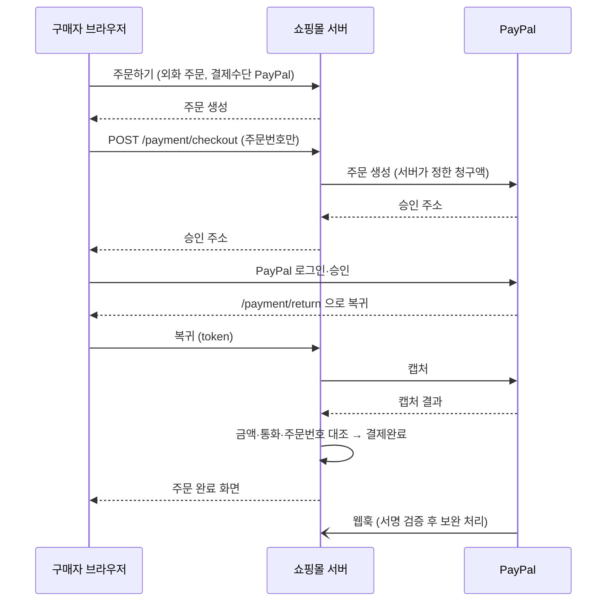

# 그누보드7 페이팔 플러그인

**그누보드7 플러그인 · g7plus-paypal**
해외 고객용 PayPal 결제 (Orders v2 · 외화 결제 · 부분환불 · 웹훅 서명 검증)

<!-- @generated:badges START — ext:docgen 이 갱신. 이 블록 안은 직접 수정하지 않는다 -->
<p align="center">
  
  
  
  
  
</p>
<!-- @generated:badges END -->

---

[소개](#소개) · [주요 기능](#주요-기능) · [동작 방식](#동작-방식) · [요구 사항](#요구-사항) · [설치](#설치) · [관리자 설정](#관리자-설정) · [사용 방법](#사용-방법) · [다른 확장과의 연동](#다른-확장과의-연동) · [문서](#문서) · [트러블슈팅](#트러블슈팅) · [변경 이력](#변경-이력) · [라이선스](#라이선스)

---

## 소개

<!-- @intent START -->
해외 고객이 그누보드7 쇼핑몰(sirsoft-ecommerce)에서 **PayPal 계정 또는 카드로 외화 결제**를 할 수 있게 합니다.
국내 PG(토스·KG이니시스·KCP·나이스)는 원화 결제용으로 그대로 두고, 이 플러그인은 USD·EUR·JPY 같은 외화 주문에만
나타납니다. 어떤 통화를 PayPal 로 받을지는 관리자 화면에서 고릅니다.

PayPal 은 원화(KRW)를 지원하지 않으므로 **원화 주문에는 PayPal 이 노출되지 않습니다.**
교환·반품 배송비 같은 클레임 추가결제도 PayPal 로 받고 돌려줄 수 있습니다(이커머스 클레임 정책의 추가결제 수단에 `paypal` 을 넣으면 됩니다).
<!-- @intent END -->

## 주요 기능

<!-- @intent START -->
| 영역 | 설명 |
|---|---|
| 결제 | PayPal Checkout (Orders v2) — PayPal 계정·카드(게스트)·Pay Later 등 PayPal 이 제공하는 결제수단 |
| 통화 | PayPal 지원 24개 통화 중 운영자가 고른 통화만 노출, JPY·HUF·TWD 무소수 처리 |
| 보안 | 서버가 금액 결정, 캡처 금액·통화·주문번호 대조(불일치 시 자동 환불), 웹훅 서명 검증, 주문 소유자 확인 |
| 안정성 | 더블클릭·새로고침·웹훅 동시 도착에도 1회만 결제 처리(멱등키 + 주문 락), 승인 후 창을 닫아도 웹훅이 결제 완료 |
| 환불 | 관리자 주문 취소·반품 시 PayPal 자동 환불, 부분환불(180일 이내) |
| 판매자 보호 | 해외 배송지를 PayPal 에 함께 전달(PayPal 이 주소를 거절하면 배송지 없이 재시도) |
| 클레임 추가결제 | 교환·반품 배송비 등 추가결제를 PayPal 로 받고, 신청 철회·차액 정산 시 PayPal 로 환급 |
| 연결 테스트 | 설정 화면에서 API 키 인증·웹훅 등록 주소·구독 이벤트를 버튼 하나로 점검 |
| 관리 | 주문 상세에 PayPal 거래 정보 패널, 체크아웃 오류 안내창 |
<!-- @intent END -->

## 동작 방식

<!-- @intent START -->

<!-- @intent END -->

## 요구 사항

<!-- @generated:requirements START — ext:docgen 이 갱신. 이 블록 안은 직접 수정하지 않는다 -->
| 항목 | 값 |
|---|---|
| 그누보드7 코어 | `>=7.1.1` |
| PHP | `^8.2` |
| 의존 모듈 | `sirsoft-ecommerce` `>=1.3.0` |
<!-- @generated:requirements END -->

## 설치

<!-- @generated:install START — ext:docgen 이 갱신. 이 블록 안은 직접 수정하지 않는다 -->
```bash
# 번들 설치 (코어에 동봉된 소스에서 설치)
php artisan plugin:install g7plus-paypal

# 활성화
php artisan plugin:activate g7plus-paypal

# 업데이트 (번들 소스 기준 강제 반영)
php artisan plugin:update g7plus-paypal --force
```

저장소: https://github.com/hwaryeon1234/g7_paypal_plugin
<!-- @generated:install END -->

## 관리자 설정

<!-- @generated:settings-summary START — ext:docgen 이 갱신. 이 블록 안은 직접 수정하지 않는다 -->
| 키 | 의미 | 기본값 |
|---|---|---|
| `is_sandbox` | 샌드박스 모드 | `true` |
| `sandbox_client_id` | 샌드박스 Client ID | - |
| `sandbox_client_secret` | 샌드박스 Secret | - |
| `sandbox_webhook_id` | 샌드박스 Webhook ID | - |
| `live_client_id` | 라이브 Client ID | - |
| `live_client_secret` | 라이브 Secret | - |
| `live_webhook_id` | 라이브 Webhook ID | - |
| `allowed_currencies` | PayPal 결제 허용 통화 | `["AUD","BRL","CAD","CNY","CZK","DKK","EUR","HKD","HUF","ILS","JPY","MYR","MXN","TWD","NZD","NOK","PHP","PLN","GBP","SGD","SEK","CHF","THB","USD"]` |
| `brand_name` | PayPal 결제창 상호명 | - |
| `landing_page` | PayPal 첫 화면 | `NO_PREFERENCE` |
| `redirect_success_url` | 결제 성공 리다이렉트 URL | `{shopBase}/orders/{orderId}/complete` |
| `redirect_fail_url` | 결제 실패 리다이렉트 URL | `{shopBase}/checkout` |

개발자용 상세(타입·검증·저장 위치)는 [설정 스키마](docs/settings.md#설정-스키마) 를 보세요.
<!-- @generated:settings-summary END -->

<!-- @intent START -->
- **샌드박스 모드**: 켜져 있으면 샌드박스 키만 씁니다. 라이브 키를 넣고 **끄는 순간 실제 결제**가 됩니다.
- **Webhook ID**: 비워 두면 웹훅을 전부 거절합니다. 결제 자체는 되지만, 승인 후 창을 닫은 구매자의 결제 마무리와 보류(PENDING) 결제 완료가 자동으로 되지 않습니다 — 반드시 등록하세요.
- **허용 통화**: 해제한 통화로 주문하면 체크아웃에 PayPal 이 보이지 않고, 직접 API 를 호출해도 주문 생성이 거절됩니다. 쇼핑몰에 없는 통화를 골라도 영향은 없습니다.
- **상호명·첫 화면**: PayPal 승인 화면의 표시만 바꿉니다. 「카드 결제(게스트)」는 PayPal 계정 없는 고객에게 카드 입력 화면을 먼저 보여 줍니다.
<!-- @intent END -->

## 사용 방법

<!-- @intent START -->
**설치하기** — 관리자 > 플러그인 > GitHub 에서 설치에 아래 주소를 넣습니다. 이커머스(sirsoft-ecommerce) 모듈이 먼저 설치돼 있어야 합니다.

```text
https://github.com/hwaryeon1234/g7_paypal_plugin
```

설치 후 「활성화」를 누릅니다. 새 버전은 GitHub Release 로 배포되며, 관리자 > 플러그인 목록에 업데이트 알림이 뜨면 「업데이트」를 누르면 됩니다.

명령줄로 설치하려면 G7 루트에서 원본을 `plugins/_pending/g7plus-paypal` 에 두고 설치합니다(디렉터리 이름은 반드시 `g7plus-paypal`).

```bash
git clone --depth 1 https://github.com/hwaryeon1234/g7_paypal_plugin plugins/_pending/g7plus-paypal
php artisan plugin:install g7plus-paypal
php artisan plugin:activate g7plus-paypal
```

이미 설치한 사이트에서 Release zip 으로 직접 업데이트하려면 `php artisan plugin:update g7plus-paypal --zip=/경로/파일.zip` 을 씁니다.

**일본어 화면** — 관리자 > 언어팩 > URL 에서 설치에 아래 주소를 넣습니다(일본어 코어 언어팩이 켜져 있어야 합니다). 자세한 내용은 [lang-pack/README.md](lang-pack/README.md).

```text
https://github.com/hwaryeon1234/g7_paypal_plugin/releases/latest/download/g7plus-plugin-g7plus-paypal-ja.zip
```

**처음 연결하기**
1. [developer.paypal.com](https://developer.paypal.com) > Apps & Credentials 에서 앱을 만들고 Sandbox Client ID·Secret 을 관리자 > 플러그인 > PayPal 설정에 입력합니다.
2. 같은 앱의 Webhooks 에 설정 화면의 웹훅 URL 을 등록하고, 화면에 나온 이벤트 5개를 선택합니다. 발급된 Webhook ID 를 입력합니다.
3. 이커머스 설정 > 언어·통화에 USD 등 외화를 추가합니다(환율 포함).
4. 이커머스 설정 > 주문 설정 > 결제수단에서 「PayPal」을 켭니다.
5. 쇼핑몰에서 통화를 USD 로 바꿔 주문하고, 샌드박스 구매자 계정으로 결제해 봅니다.
6. 라이브 앱 키·라이브 Webhook ID 를 입력하고 샌드박스 모드를 끕니다.

**환불**: 관리자 주문 상세에서 평소처럼 주문 취소·부분 취소를 하면 PayPal 로 자동 환불됩니다. PayPal 대시보드에서 직접 환불하면 쇼핑몰 주문은 바뀌지 않으니 쇼핑몰에서 환불하세요.
<!-- @intent END -->

## 다른 확장과의 연동

<!-- @generated:integrations START — ext:docgen 이 갱신. 이 블록 안은 직접 수정하지 않는다 -->
**이 확장이 의존하는 확장**

| 확장 | 유형 | 버전 제약 | 번들 |
|---|---|---|---|
| `sirsoft-ecommerce` | 모듈 | `>=1.3.0` | ✅ |

**이 확장에 의존하는 확장** (이 확장을 비활성화하면 함께 영향을 받습니다)

없음.
<!-- @generated:integrations END -->

## 문서

<!-- @generated:docs-index START — ext:docgen 이 갱신. 이 블록 안은 직접 수정하지 않는다 -->
| 문서 | 내용 | 상태 |
|---|---|---|
| [docs/README.md](docs/README.md) | 문서 통합 목차와 실측 집계 | ✅ |
| [docs/architecture.md](docs/architecture.md) | 설계 의도·계층 지도·디렉토리 맵 | ✅ |
| [docs/extension-points.md](docs/extension-points.md) | 발행/구독 훅·미들웨어·채널·스케줄 | ✅ |
| [docs/data-model.md](docs/data-model.md) | 모델·소유 테이블·마이그레이션·Enum | ✅ |
| [docs/settings.md](docs/settings.md) | 설정 스키마·권한·메뉴·라우트·의존 관계 | ✅ |
| [docs/frontend.md](docs/frontend.md) | 레이아웃·액션 핸들러·전역 진입점·에셋 | ✅ |
| [docs/editor-spec.md](docs/editor-spec.md) | 레이아웃 편집기에 선언한 팔레트·컨트롤·샘플 데이터 | ✅ |
| [docs/api/](docs/api/README.md) | API 레퍼런스 (엔드포인트별 파라미터·응답 필드) | ✅ |
| [CHANGELOG.md](CHANGELOG.md) | 변경 이력 | ✅ |
<!-- @generated:docs-index END -->

## 트러블슈팅

<!-- @intent START -->
| 증상 | 원인 | 조치 |
|---|---|---|
| 체크아웃에 PayPal 이 안 보임 | 원화 주문이거나, 허용 통화에서 빠졌거나, 이커머스 결제수단에서 꺼져 있음 | 쇼핑몰 통화를 외화로 바꿔 확인 → 허용 통화 → 이커머스 주문 설정 > 결제수단 |
| 「PayPal 인증에 실패했습니다」 | Client ID/Secret 오류, 샌드박스 키를 라이브 모드에서 사용 | 모드와 키 짝 확인 |
| 「이 금액은 PayPal 로 결제할 수 없습니다」 | JPY·HUF·TWD 주문에 소수 금액이 생김 (통화 소수 자릿수 설정) | 이커머스 통화 설정에서 해당 통화 소수 자릿수를 0 으로 |
| 웹훅이 400 으로 실패 | Webhook ID 미입력·모드 불일치 | 모드에 맞는 Webhook ID 입력 |
| 결제는 됐는데 주문이 결제대기 | 캡처 보류(PENDING, eCheck·심사) | PayPal 이 완료하면 웹훅으로 자동 결제완료 — 웹훅 등록 확인 |
| 로그에 `compensating refund failed` (critical) | 금액 불일치로 자동 환불을 시도했으나 실패 | PayPal 대시보드에서 해당 캡처 ID 를 직접 환불 |
| 로그에 `capture reversed (chargeback)` | 구매자 분쟁·지급 거절 | PayPal Resolution Center 에서 대응 |
<!-- @intent END -->

## 변경 이력

[CHANGELOG.md](CHANGELOG.md)

## 라이선스

MIT
